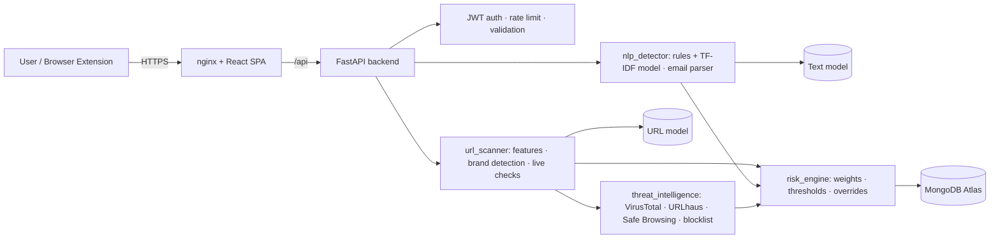

# Architecture

## Request lifecycle (URL scan)
1. Input validated (length, scheme allow-list, no whitespace/script schemes).
2. `url_scanner.features` → 24 static features; `detect_brand` flags look-alikes (leet-speak, edit distance, brand keywords).
3. ML model returns class probabilities → expected-risk score.
4. Rules add human-readable reasons. Live checks (DNS, TLS, RDAP domain age, redirects, static page inspection) run only if `LIVE_NETWORK_CHECKS=true` and every hop passes the SSRF guard.
5. Threat-intel providers run in parallel; each is optional and failures never break a scan.
6. `risk_engine.fuse` merges signals → score, verdict, confidence; `recommendations` produce next steps.
7. Result stored in the user's history and returned.

## Scalability
Stateless API containers (scale horizontally behind a load balancer); state lives in MongoDB Atlas. Replace the in-memory rate limiter with Redis when running >1 instance. Models are loaded once per worker.
